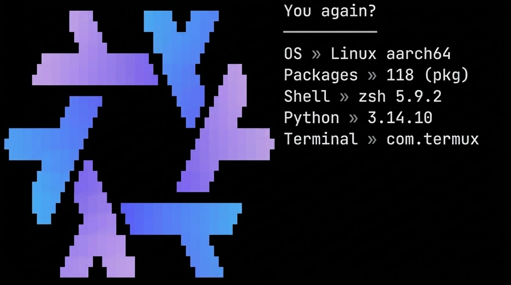

<div align="center">

# hexfetch

**A fast system information fetch for Linux, in a single static Go binary.**

Gradient hexos logo + 530 embedded distro logos · 62 modules · YAML configuration · x86, ARM, RISC-V and Termux


[Install](#install) · [Quick start](#quick-start) · [Configuration](#configuration) · [Modules](#modules) · [Releases](https://github.com/oversonv/hexfetch/releases)



<sub>Termux on Android (aarch64) with a customized module list.</sub>

</div>

## Highlights

- **Fast.** About 5 ms per run with the default layout (x86_64, average of 100 runs).
- **One file.** A 7–8 MiB binary with no runtime dependencies. Linux builds are fully static (`CGO_ENABLED=0`).
- **Six targets.** `linux-amd64`, `linux-arm64`, `linux-armv7`, `linux-386`, `linux-riscv64` and `android-arm64` (Termux).
- **62 modules** that run concurrently: system, software, desktop, hardware, network and media.
- **Logos.** The default `hexos` logo has six gradient bands and 1, 2 or 12 configurable colors. 530+ distribution logos are embedded too (`--logo NAME`, `--logo auto`). Falls back to ANSI 256 colors automatically.
- **Predictable configuration.** One YAML file; CLI flags override it; unknown or invalid settings produce a warning instead of a silent failure.
- **Terminal-aware.** Output is clipped to the terminal width and the logo hides itself when there is no room.
- **Tested without your hardware.** Module tests run against fixtures in `modules/testdata`.

## Install

### Prebuilt binary

Download the file for your platform and `SHA256SUMS` from the [Releases](https://github.com/oversonv/hexfetch/releases) page.

| Target | Platform |
| --- | --- |
| `linux-amd64` | 64-bit x86 Linux |
| `linux-arm64` | 64-bit ARM Linux |
| `linux-armv7` | 32-bit ARM Linux (ARMv7) |
| `linux-386` | 32-bit x86 Linux |
| `linux-riscv64` | 64-bit RISC-V Linux |
| `android-arm64` | Android arm64 (Termux) |

With one binary and `SHA256SUMS` in the current directory:

```sh
sha256sum -c SHA256SUMS --ignore-missing
chmod +x hexfetch_*
mkdir -p ~/.local/bin && mv hexfetch_* ~/.local/bin/hexfetch
```

In Termux, install it into `$PREFIX/bin` instead: `mv hexfetch_* "$PREFIX/bin/hexfetch"`.

The Linux binaries are static. The Android build uses the system linker (`/system/bin/linker64`) and needs no extra libraries.

### Build from source

Requires Go 1.26 or newer (see `go.mod`).

```sh
git clone https://github.com/oversonv/hexfetch.git
cd hexfetch
CGO_ENABLED=0 go build -o hexfetch ./cmd/hexfetch
./hexfetch --version
```

## Quick start

```sh
hexfetch                                   # default layout
hexfetch --gen-config                      # write $HOME/hex/set/hexfetch.yaml
hexfetch -s "title:separator:os:kernel:uptime"
hexfetch --logo arch                       # another embedded logo (see --list-logos)
hexfetch --logo auto                       # logo of the running distribution
hexfetch --logo-position right --padding 4
hexfetch --list-logos
hexfetch --list-modules --verbose          # every module with category and description
```

## Command-line reference

Boolean flags also accept `=true` or `=false`.

| Flag | Default | Description |
| --- | --- | --- |
| `-c, --config PATH` | `$HOME/hex/set/hexfetch.yaml` | Personal YAML config file. Also the destination for `--gen-config` and `--migrate-config` |
| `-s, --structure LIST` | from config | Colon-separated modules to print. Selection and order only; module settings still come from YAML |
| `-l, --logo NAME` | `hexos` | Logo name or alias, `auto` (from `/etc/os-release`) or `none` |
| `-p, --logo-position SIDE` | `left` | Logo side: `left` or `right` |
| `--padding N` | `2` | Spaces between the logo and the modules |
| `--logo-colors LIST` | built-in | `hexos` only: 12, 2 or 1 comma-separated `38;2;R;G;B` values |
| `--separator STR` | `" » "` | Separator between key and value |
| `--key-type TYPE` | `string` | Key display: `string`, `icon` or `both` |
| `--color-keys N` | `4` | ANSI 256-color index for module keys (0–255) |
| `--no-color` | off | Disable all colors |
| `--gen-config` | | Write the default YAML config. Never overwrites an existing file |
| `--migrate-config` | | Convert the legacy TOML config to YAML ([details](#legacy-toml-migration)) |
| `--list-logos` | | List embedded logos |
| `--list-modules` | | List available modules |
| `--verbose` | | With `--list-modules`: add categories and descriptions |
| `--debug` | off | Show diagnostic details and skipped modules |
| `--show-errors` | off | Show skipped modules and the reason |
| `--quiet` | off | Hide diagnostics |
| `-h, --help` | | Show help |
| `-v, --version` | | Show the version |

Layout options (`--logo-position`, `--padding`) are CLI-only and are not stored in YAML.

## Configuration

Defaults are built into the binary (`internal/config/default.yaml`, embedded with `go:embed`). Your personal file is `$HOME/hex/set/hexfetch.yaml`; it is layered on top of the defaults, so it only needs the settings you change. Use `-c PATH` to load another file. A missing default file is fine; a missing `-c` file produces a warning.

```sh
hexfetch --gen-config
```

`--gen-config` creates the parent directory if needed. If the file already exists, it exits with status 1 and leaves the file untouched.

A Termux-style profile (Fastfetch-like icons, Python version via the `command` module) is described in [docs/termux-profile.md](docs/termux-profile.md).

<details>
<summary>Default configuration</summary>

```yaml
# hexfetch default configuration (embedded into the binary).
# Personal settings go to $HOME/hex/set/hexfetch.yaml and are layered on top of this file.
# Create that file with: hexfetch --gen-config
hexfetch:
  # Logo name, "auto" (pick from /etc/os-release) or "none". List names with: hexfetch --list-logos
  logo: hexos
  # Colors of the hexos logo only; other logos use their own flat colors.
  # 12 colors: start and end color of each of the 6 gradient bands (the vanilla colors below).
  # 2 colors: one start and one end color shared by all bands. 1 color: a flat logo.
  # Remove the list to use the vanilla colors.
  logo_colors:
    - "38;2;133;104;242"
    - "38;2;206;177;240"
    - "38;2;107;106;255"
    - "38;2;79;185;254"
    - "38;2;206;177;240"
    - "38;2;133;104;242"
    - "38;2;79;185;254"
    - "38;2;107;106;255"
    - "38;2;206;177;240"
    - "38;2;133;104;242"
    - "38;2;107;106;255"
    - "38;2;79;185;254"
  display:
    separator: " » "
    separator_char: "-"
    color:
      keys: "1;38;2;150;150;150"
      title: "38;2;255;255;255"
      output: "38;2;255;255;255"
      separator: "38;2;130;140;138"
  modules:
    items:
      - title
      - separator
      - shell
      - terminal
      - terminalfont
      - wm
      - de
      - theme
      - icons
      - cursor
      - packages
      - uptime
    title:
      format: "Welcome!"
```

</details>

### Schema

Everything lives under the `hexfetch` key (the old `nixfetch` key is still accepted as a deprecated alias and produces a warning). `logo` is a plain string, not a section.

| Key | Type | Description |
| --- | --- | --- |
| `logo` | string | `hexos` (default), any logo name or alias, `auto` or `none` ([Logo and colors](#logo-and-colors)) |
| `logo_colors` | list of 1, 2 or 12 SGR strings | `hexos` gradient colors ([Logo and colors](#logo-and-colors)) |
| `display.separator` | string | Text between key and value |
| `display.separator_char` | string | Character used by `separator` modules (default `-`) |
| `display.color.keys` / `title` / `output` / `separator` | color | Colors of keys, title, values and separator lines |
| `display.key.type` | `string` \| `icon` \| `both` | Key display. `--key-type` overrides it |
| `modules.items` | list of module names | Which modules run, and in which order |
| `modules.<name>` | mapping | Settings of one module |

**Colors** accept a palette number (0–255), a name (`black`, `red`, `green`, `yellow`, `blue`, `magenta`, `cyan`, `white`, with an optional `light_` or `bright_` prefix) or an ANSI SGR string such as `1;38;2;150;150;150`.

**Precedence:** CLI flag, then YAML, then built-in default. Normal module rows share a calculated key column, so values stay aligned even when icons or key names have different terminal widths.

### Selecting modules

- A settings block does not enable a module. Add the module name to `modules.items`.
- The default list starts with `title`, then `separator`. A custom list must include `title` explicitly to show it.
- A `separator` without a `title` is as wide as the widest output and produces a warning.
- Repeating a name runs the module again with the same settings. Different settings per instance are not supported.
- `--structure` replaces selection and order but reuses the YAML settings of each selected module.
- Unknown modules, sections, fields and option names produce a warning and are ignored. An invalid value keeps the previous default or configured value.

### Module fields

| Modules | Accepted fields |
| --- | --- |
| Ordinary output modules | `key`, `key_icon`, `key_color`, `format`, `options` |
| `title` | `text`, `format` |
| `custom` | `key`, `key_icon`, `text`, `key_color` |
| `command` | `key`, `key_icon`, `text`, `command`, `key_color`, `format` |
| `separator`, `break`, `colors` | none |

Options are validated against the schema owned by each module. Currently supported:

| Module | Option | Values |
| --- | --- | --- |
| `cpuusage` | `interval_ms` | Integer or decimal string, 1–2000 (default 150) |
| `localip` | `family` | `both`, `4`, `ipv4`, `6`, `ipv6` |
| `localip` | `interface` | String |
| `localip` | `exclude` | String or list of strings |
| `publicip` | `url` | Absolute HTTP(S) URL |
| `weather` | `url` | Absolute HTTP(S) URL |

### Examples

Network information with a custom endpoint:

```yaml
hexfetch:
  modules:
    items:
      - title
      - localip
      - publicip
    title:
      format: "System overview"
    localip:
      options:
        family: "4"
        interface: "wlan0"
        exclude:
          - docker
          - veth
    publicip:
      options:
        url: "https://api.ipify.org"
```

Your own command as a line. `command` is not part of the default list, so add it to `items`:

```yaml
hexfetch:
  modules:
    items:
      - title
      - separator
      - os
      - command
    command:
      key: "Python"
      text: "python3 -V 2>&1 | cut -d' ' -f2"
```

> [!WARNING]
> `command` runs through `sh -c` with a 3-second timeout. Treat the config file as code and do not load configs you do not trust.

Key icons work as in fastfetch. Set `display.key.type` to `icon` or `both` and give a module a `key_icon`. Most glyphs need a Nerd Font. A module without `key_icon` always prints its plain key.

```yaml
hexfetch:
  display:
    key:
      type: both
  modules:
    items:
      - title
      - separator
      - os
      - shell
    os:
      key: "OS"
      key_icon: "\uf313"
```

### Legacy TOML migration

<details>
<summary>Moving from <code>$HOME/nixos/nixos.toml</code></summary>

Old `nixos.toml`, `config.jsonc` and `config.json` files are not loaded automatically. If the default YAML file is missing and a legacy TOML file exists, hexfetch prints a warning with its path.

```sh
hexfetch --migrate-config                 # writes $HOME/hex/set/hexfetch.yaml
hexfetch --migrate-config -c ./new.yaml   # choose the destination
```

The migration validates the converted settings and writes only supported, normalized values. It keeps the original TOML, drops obsolete logo settings, reports unsupported fields and refuses to overwrite an existing destination. A legacy title missing from `modules.items` is inserted before the first separator, or at the start of the list. JSONC is not migrated.

</details>

## Logo and colors

All logos are embedded in the binary (`logo/ascii/<letter>/<name>.txt`); hexfetch reads no logo files from disk. The default is `hexos`. Choose another one with `logo:` in YAML or `--logo`:

- `--list-logos` prints every name. Aliases such as `amzn` or `hex` resolve to their logo.
- `auto` picks the logo from `/etc/os-release` (`ID`, `ID_LIKE`, `NAME`). If nothing matches, `hexos` is used.
- `none` prints no logo.
- An unknown name prints a warning and `hexos` is used.

**hexos colors.** The `hexos` logo has six gradient bands with fixed geometry and direction. Only the endpoint colors are configurable through `logo_colors` (or `--logo-colors`):

| Values | Meaning |
| --- | --- |
| none, or an empty list | The vanilla colors |
| 12 | Start and end color of each band: values `2n+1` and `2n+2` belong to band `n` (bands 0–5) |
| 2 | One start and one end color shared by all six bands |
| 1 | One flat color for the whole logo |

```sh
hexfetch --logo-colors "38;2;255;94;98,38;2;255;153;102"   # every band: coral to orange
hexfetch --logo-colors "38;2;255;94;98"                     # flat coral
```

- Each value must be `38;2;R;G;B` with channels 0–255.
- Any other count (3–11, more than 12) is ignored with a warning and the vanilla colors are kept.
- With 12 values an invalid item keeps its own default and valid neighbors stay active. With 1 or 2 values an invalid item rejects the whole list.
- `--logo-colors` is applied on top of YAML. With 12 values an invalid item leaves the configured value unchanged.
- Other logos use the flat colors from `logo/colors.txt` and ignore `logo_colors`.
- Spaces are never colored, and every colored line ends with an ANSI reset.

**Logo file format.** `$1`..`$9` switch to the corresponding color slot and `$$` prints a literal `$`. For classic logos each slot is one flat color from `logo/colors.txt` (`name=sgr:34,sgr:37` or `name=79;157;207`). For `hexos`, slot `n` is gradient band `n-1`.

**Color depth.** hexfetch uses truecolor when `COLORTERM` is `truecolor` or `24bit`. Otherwise it also uses truecolor unless `TERM` is one of `linux`, `dumb`, `vt100`, `vt220`, `ansi` or `screen`, in which case the logo is converted to the nearest ANSI 256-color codes.

## Output behavior

| Situation | Behavior |
| --- | --- |
| stdout is not a terminal (pipe, file) | No colors and no clipping |
| `--no-color` or non-empty `NO_COLOR` | No ANSI sequences, for output and diagnostics |
| Output wider than the terminal | Lines are clipped to the terminal width |
| Terminal too narrow for the left logo and the text | The logo is hidden and a warning is printed |
| Width reported as 0 (some proot or pty setups) | Falls back to stderr, stdin, `/dev/tty`, then `COLUMNS` |

## Modules

Run `hexfetch --list-modules --verbose` for the same list from your binary.

<details>
<summary>All 62 modules</summary>

**System**

| Module | Description |
| --- | --- |
| `title` | User and host name |
| `separator` | Horizontal separator line |
| `break` | Blank line |
| `colors` | 16-color palette, adapts to the terminal width |
| `custom` | Custom text from the config |
| `command` | Output of a shell command (external) |
| `os` | Operating system name |
| `kernel` | Kernel release |
| `uptime` | System uptime |
| `datetime` | Current date and time |
| `locale` | Locale from the environment |
| `users` | Logged-in users |
| `initsystem` | Init system |
| `bootmgr` | Boot manager |
| `loadavg` | Load average |
| `processes` | Number of processes |
| `osage` | Approximate OS install age |

**Software**

| Module | Description |
| --- | --- |
| `shell` | Current shell and version |
| `terminal` | Terminal emulator |
| `terminalfont` | Terminal font |
| `packages` | Installed packages |

**Desktop**

| Module | Description |
| --- | --- |
| `wm` | Window manager |
| `de` | Desktop environment |
| `theme` | GTK theme |
| `icons` | Icon theme |
| `cursor` | Cursor theme |
| `font` | GTK font |
| `wallpaper` | Current wallpaper (external) |
| `wmtheme` | Window manager theme (external) |

**Hardware**

| Module | Description |
| --- | --- |
| `host` | Device model |
| `board` | Motherboard |
| `bios` | BIOS or UEFI |
| `product` | System vendor and product |
| `chassis` | Chassis type |
| `chassistype` | Extended chassis type |
| `cpu` | CPU model, cores and frequency |
| `cpucache` | CPU cache sizes |
| `cpuusage` | CPU utilization |
| `memory` | Memory usage |
| `swap` | Swap usage |
| `battery` | Battery charge and status |
| `poweradapter` | External power adapter |
| `temperature` | Hardware temperatures |
| `fans` | Fan speeds |
| `brightness` | Screen brightness |
| `sound` | Sound card |
| `display` | Connected displays |
| `monitor` | Monitor model via EDID |
| `gpu` | Graphics adapters |
| `gpuusage` | GPU utilization |
| `disks` | Mounted filesystem usage |
| `physicaldisk` | Physical disk models |
| `diskio` | Disk I/O totals |
| `camera` | Video capture devices |

**Network**

| Module | Description |
| --- | --- |
| `localip` | Local IP addresses |
| `wifi` | Wi-Fi interface, SSID and signal |
| `bluetooth` | Bluetooth controllers |
| `dns` | DNS servers |
| `publicip` | Public IP address (network request) |

**Media**

| Module | Description |
| --- | --- |
| `media` | Currently playing media (external) |
| `player` | Currently playing media (external) |
| `weather` | Weather report (external, network request) |

</details>

Notes:

- `publicip` and `weather` make network requests only when listed in `modules.items`. The endpoint comes from the `url` option or from `HEXFETCH_PUBLIC_IP_URL` and `HEXFETCH_WEATHER_URL`.
- `command`, `wallpaper`, `wmtheme`, `media`, `player` and `weather` call external programs such as `playerctl`, `swww`, `hyprctl`, `gsettings` and `xfconf-query`, with timeouts.
- `cpuusage` takes two `/proc/stat` samples about 150 ms apart. `gpuusage` reads amdgpu sysfs or calls `nvidia-smi`.
- Hardware modules read `/proc` and `/sys`. Where those are restricted (containers, proot, Android), the affected modules are skipped.

## Diagnostics

Diagnostics go to stderr before the output.

| Level | Meaning | Shown |
| --- | --- | --- |
| `Error` | A module failed. The remaining output is still rendered | Always |
| `Warning` | Configuration, logo or module-selection problem | Always |
| `Info` | Loaded config path, modules that do not apply to this system | Only with `--debug` or `--show-errors` |

- `--debug` (or `HEXFETCH_DEBUG=1`) also adds the underlying error or panic stack.
- `--quiet` hides all diagnostics.
- Diagnostic colors are used only when stderr is a terminal.
- Modules that do not apply to the system are skipped silently.

### Exit status

| Code | When |
| --- | --- |
| `0` | Normal run. Diagnostics never change the exit status, including unknown modules |
| `1` | `--gen-config` or `--migrate-config` failed (for example, the file already exists), or the output could not be written |
| `2` | Invalid command-line flag |

## Environment variables

| Variable | Effect |
| --- | --- |
| `NO_COLOR` | Any non-empty value disables ANSI colors |
| `HEXFETCH_DEBUG` | `1` or `true` enables `--debug` |
| `HEXFETCH_PUBLIC_IP_URL` | Default endpoint of `publicip` |
| `HEXFETCH_WEATHER_URL` | Default endpoint of `weather` |
| `COLORTERM`, `TERM` | Color depth detection |
| `COLUMNS` | Last-resort terminal width |

The old `NIXFETCH_DEBUG`, `NIXFETCH_PUBLIC_IP_URL` and `NIXFETCH_WEATHER_URL` names still work as deprecated fallbacks.

## Platform support

hexfetch is Linux-only by design. Windows and macOS are not supported. Android is supported through Termux (`android-arm64`, `aarch64`).

## Development

```sh
gofmt -l .
go vet ./...
go test ./...
```

Module tests run against fixtures in `modules/testdata`, so they do not depend on the host system.

```text
cmd/hexfetch/      entry point and main flow
internal/cli/      flag parsing
internal/config/   YAML loading, validation, TOML migration
internal/gradient/ gradient math and color-depth detection
internal/logo/     logo catalog, parser and painters (classic and hexos)
logo/              embedded logo art, colors.txt, aliases.txt
internal/render/   layout, clipping, terminal width
internal/diag/     diagnostics collector and printer
modules/           one file per module, plus testdata/ fixtures
```

**Adding a module.** Create one file in `modules/` that registers the module in `init()` with `Register`, and add an entry to `modules/metadata.go` so that `--list-modules --verbose` shows its category and description.

**Releases.** `release.py` builds the six targets (`-trimpath`, stripped, `CGO_ENABLED=0`), writes `SHA256SUMS`, fills `release_template.md` and uploads the assets with `gh`.

## Credits

The distribution logos are derived from the [fastfetch](https://github.com/fastfetch-cli/fastfetch) project (MIT License). See [THIRD_PARTY_LICENSES](THIRD_PARTY_LICENSES). The `hexos` logo is original to hexfetch.

## License

MIT. See [LICENSE](LICENSE).
